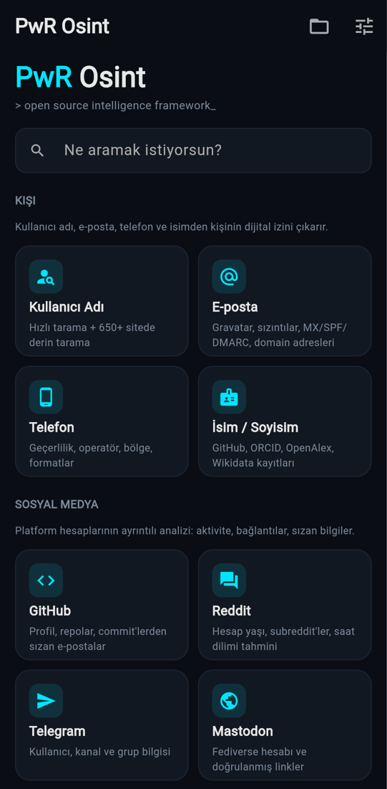
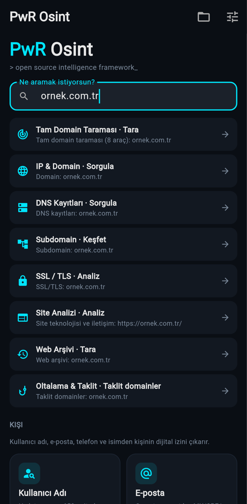
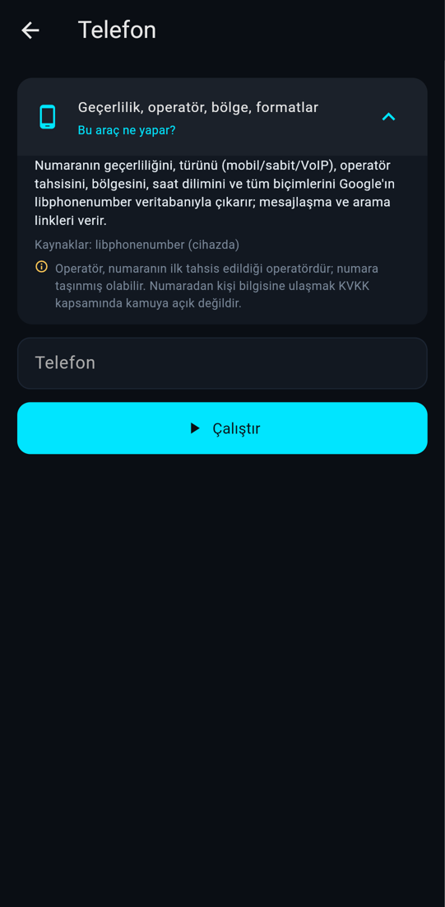
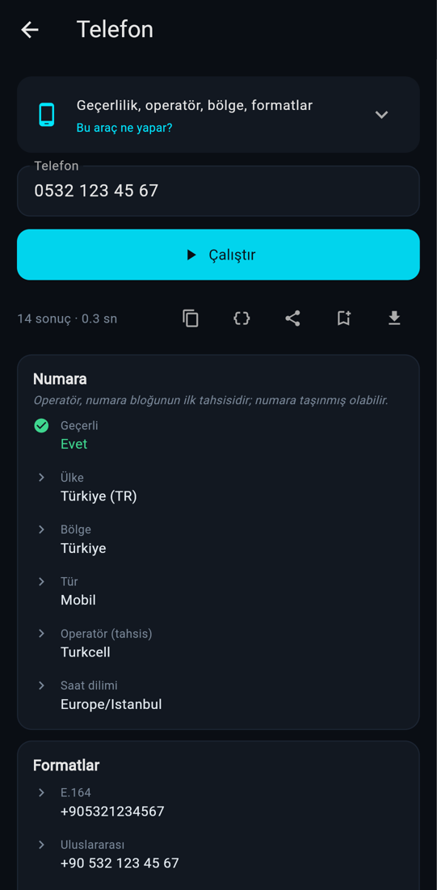

# PwR Osint

**PwR Osint**, telefonda çalışan açık kaynak bir OSINT (açık kaynak istihbarat) ve siber güvenlik keşif aracıdır. Kişi, sosyal medya, domain, IP, web sitesi, sızıntı, zafiyet, ağ yönetimi, dolandırıcılık ve oltalama, şüpheli dosyalar, kripto para ve fotoğraf için **43 araç ve 65 işlem** sunar. Çoğu API anahtarı gerektirmez.

Aynı çekirdek üç arayüzden kullanılır:

- 📱 **Android uygulaması**: akıllı arama, kart tabanlı sonuçlar, rapor kaydetme ve HTML dışa aktarma
- 💻 **Etkileşimli terminal**: Windows, Linux ve macOS
- ⚙️ **Komut satırı**: tek satırlık sorgular, `--json` ve `--html` çıktısı

> **Coded by BagwelPower**

| Ana ekran | Akıllı arama | Araç bilgisi | Sonuç |
|---|---|---|---|
|  |  |  |  |

---

## ✨ Öne çıkanlar

- **Akıllı arama.** Ne yazarsanız (e-posta, IP, domain, URL, telefon, hash, kripto adresi, ASN, VIN, plaka, koordinat, kullanıcı adı) türünü tanır ve ilgili araçları önerir.
- **Önemli bulgular.** Her raporun başında, bütün bölümlerden toplanmış kritik ve dikkat gerektiren bulgular yer alır: süresi dolan sertifika, internete açık veritabanı portu, sızmış şifre, GPS konumu, e-posta alabilen taklit domain gibi.
- **Anahtarsız çalışır.** Shodan, VirusTotal, Have I Been Pwned ve Hunter.io anahtarı yoksa ücretsiz yedek kaynaklar kullanılır ve raporda hangi kaynağın kullanıldığı yazılır.
- **Kaynak durumu.** Limiti dolan ya da yanıt vermeyen kaynaklar sonuçlara karışmaz; raporun altında ayrıca listelenir.
- **Pivot.** Sonuçtaki bir e-posta, IP ya da domain tek dokunuşla ilgili araçta açılır.
- **Tam Domain Taraması.** 8 araç tek raporda çalışır: altyapı, DNS, TLS, subdomain, site, urlscan, arşiv, taklit domainler.
- **Raporlar.** Raporlar cihazda saklanabilir, tek dosyalık HTML olarak dışa aktarılabilir, paylaşılabilir ya da JSON olarak kopyalanabilir.
- **Tanılama.** Ayarlar → Tanılama, bütün araçları cihazınızda çalıştırıp hangisinin çalıştığını gösterir.

---

## 🧰 Araçlar

| Kategori | Araç | Ne yapar | Anahtar |
|---|---|---|---|
| **Kişi** | Kullanıcı Adı | Hızlı tarama 23 sitede resmî API'lerle çalışır. Derin tarama, [WhatsMyName](https://github.com/WebBreacher/WhatsMyName) veri setiyle **650'den fazla** sitede tarar (hızlı bir bağlantıda yaklaşık 15 saniye; mobil ağda daha uzun sürebilir). | — |
| | E-posta | MX, SPF ve DMARC; Gravatar profili ve doğrulanmış hesaplar; bilinen sızıntılar; kurumsal domainin yaşı. Ad soyaddan adres üretir, domainin sitesindeki adresleri toplar. | Hunter (isteğe bağlı) |
| | Telefon | Geçerlilik, tür, operatör tahsisi, bölge, saat dilimi, biçimler (libphonenumber). | — |
| | İsim / Soyisim | GitHub kullanıcıları, OpenAlex akademik yazarları, ORCID ve Wikidata kayıtları, hedefli Google dork'ları. | — |
| **Sosyal Medya** | GitHub | Profil, diller, popüler repolar, organizasyonlar, **commit'lerden sızan e-postalar**, aktif saatler. | Token (isteğe bağlı) |
| | Reddit | Hesap yaşı, karma, subreddit'ler, aktif saatlerden **saat dilimi tahmini**. Reddit erişimi engellerse herkese açık arşiv kullanılır. | — |
| | Telegram | Kullanıcı, kanal, grup ya da bot olduğu; abone sayısı, açıklama. | — |
| | Mastodon | Fediverse hesabı, sunucunun doğruladığı linkler. | — |
| **Ağ & Domain** | Tam Domain Taraması | Aşağıdaki 8 aracı tek raporda birleştirir. | — |
| | IP & Domain | RDAP WHOIS, konum ve ASN, abuse iletişimi, açık portlar ve **riskli servisler**, yazılımlar, CVE'ler. | — |
| | DNS | Bütün kayıt türleri ile SPF, DMARC ve CAA değerlendirmesi, kullanılan servisler. | — |
| | SSL / TLS | Sertifika doğrulama ve kalan süre, protokol, SAN, HTTP güvenlik başlıkları. | — |
| | Subdomain | 7 pasif kaynak (crt.sh, CertSpotter, HackerTarget, OTX, Anubis, urlscan, Wayback) ve canlılık kontrolü. | — |
| | Web Arşivi | Wayback Machine'deki ilk ve son kayıt, arşivlenmiş ilginç dosyalar ve parametreli URL'ler. | — |
| | Reverse IP | Aynı sunucudaki diğer siteler. | — |
| | ASN / BGP | Ağ sahibi, IP blokları, üst sağlayıcılar (RIPEstat). | — |
| **Web** | Site Analizi | Yaklaşık 60 teknoloji imzası; sayfadaki e-posta, telefon ve sosyal hesaplar; **Analytics, AdSense ve Pixel kimlikleri**; robots.txt, sitemap, security.txt. | — |
| | urlscan.io | Geçmiş taramalar, görülen IP'ler, zararlı işaretleri. | — |
| | Google Dork | Belgeler, açık dizinler, paneller ve sızıntı siteleri için 12 hazır sorgu. | — |
| **Tehdit İstihbaratı** | Sızıntı Kontrolü | E-postanın bulunduğu sızıntılar, sızan veri türleri, şifre saklama riski. Şifre sızıntısı k-anonimlikle kontrol edilir, şifre cihazdan çıkmaz. Şifre gücünü de ölçer. | HIBP (isteğe bağlı) |
| | Shodan | Açık portlar, yazılımlar, CVE'ler. Banner bilgisi ve arama için anahtar gerekir. | Arama için |
| | Tehdit İtibarı | Domain, IP ya da dosya hash'i için AlienVault OTX tehdit raporları ve zararlı aileleri; anahtarla VirusTotal motorları. | VT (isteğe bağlı) |
| | Kara Liste | IP'nin 10 DNSBL listesindeki durumu. | — |
| | CVE Sorgusu | NVD'den CVSS, vektör ve CWE, etkilenen ürün sürümleri; **CISA KEV** (aktif istismar, fidye yazılımı), **FIRST EPSS** (istismar olasılığı); ürün adıyla arama. | — |
| **Dolandırıcılık & Oltalama** | Şüpheli Link / SMS | SMS ya da mesaj metnindeki linkleri **açmadan** inceler: kısaltıcı, IP/@ hilesi, punycode ve harf taklidi, riskli uzantı, tuzak kelimeler, marka taklidi, domain yaşı, OpenPhish ve urlscan. İsteğe bağlı, onaylı yönlendirme takibi (yalnızca HEAD isteği). | — |
| | E-posta Başlık Analizi | Oltalama incelemesi: alıcı sunucunun SPF/DKIM/DMARC kararı, From/Reply-To/Return-Path tutarlılığı, marka taklidi, teslim yolu ve gecikmeler, **gönderenin IP'si**. Çevrimdışı. | — |
| | Oltalama & Taklit | Domainin yüzlerce benzerini üretir, **kayıtlı ve e-posta alabilen** taklitleri bulur; OpenPhish akışında arar. | — |
| | IBAN Doğrulama | MOD-97 sağlama, ülkeye göre uzunluk, TR IBAN'ında banka kodu ve hesap yapısı. Hesap sahibini göstermez. Çevrimdışı. | — |
| **Ağ Araçları** | Bağlantım | Public IPv4/IPv6, operatör ve ASN, yerel IP, NAT/CGNAT, gecikme, çalışan DNS yolu. | — |
| | HTTP İnceleme | Adım adım yönlendirme zinciri ve süreleri, tüm başlıklar, CDN, çerez güvenlik bayrakları. | — |
| | Küresel Ölçüm | Dünyadaki sondalardan **ping, traceroute, MTR** ve erişilebilirlik (Globalping). | — |
| | Port Tarama ⚠ | Tek hostta 85 yaygın TCP portu, servis, banner ve riskli servis uyarıları. **Aktif, onay ister.** | — |
| | Yerel Ağ Keşfi ⚠ | Wi-Fi ağınızdaki cihazlar ve türleri (router, yazıcı, kamera, iPhone…). **Aktif, yalnızca kendi Wi-Fi ağınızda.** | — |
| | Hız Testi | Gecikme, jitter, indirme ve yükleme hızı; harcanan veri gösterilir. | — |
| **Kripto** | Kripto Adres | Bitcoin (Legacy, SegWit, Taproot; sağlama toplamı doğrulamalı) ve Ethereum: bakiye, USD ve TL karşılığı, işlemler. | — |
| **Dosya & Görsel** | Dosya Analizi | Şüpheli dosyayı **açmadan** inceler: içeriğe göre gerçek türü, yanıltıcı ve çift uzantı, entropi, içindeki URL/IP'ler; PDF'te JavaScript ve otomatik eylem, Office'te makro ve uzaktan şablon (template injection), APK'da tehlikeli izinler ve bankacılık truvası kalıbı, EXE'de paketleyici izi. Dosya cihazdan çıkmaz. | — |
| | Görsel Analizi | **Cihazdan ya da URL'den** fotoğrafın EXIF bilgisi (cihaz, tarih, seri no, düzenleme izi), **GPS konumu ve adresi**; tersine görsel arama. | — |
| **Araç Kutusu** | Subnet Hesaplayıcı | IPv4/IPv6 CIDR, maske, aralık, CGNAT tespiti, alt ağlara bölme. Çevrimdışı. | — |
| | Kod Çözücü | **JWT** çözme ve güvenlik riskleri (alg:none, HS*, süre), Base64/Hex/URL/gzip otomatik çözme, zaman damgası. | — |
| | Hash Araçları | Hash türü tanıma ve Hashcat modu; MD5/SHA/SHA3/BLAKE2/NTLM üretme. | — |
| | Şifre Üretici | Kriptografik rastgele şifre ve parola cümlesi, entropi bilgisiyle. | — |
| **Konum & Araç** | Konum | Koordinattan adres ve harita linkleri; MAC adresinden üretici, rastgele MAC tespiti, WiGLE konumu. | WiGLE (isteğe bağlı) |
| | Araç | VIN için yapı, kontrol hanesi ve NHTSA çözümlemesi; Türk plakası için il ve biçim doğrulaması. | — |

Her aracın uygulamadaki **"Bu araç ne yapar?"** kartında kaynakları ve sınırları ayrıca yazar.

---

## 📱 Android

**APK'yı indirmek için:** GitHub'da **Actions → CI & Android APK** sayfasında son başarılı çalıştırmayı açın, **Artifacts** bölümünden `PwR-Osint-apk` dosyasını indirin, zip'i açıp `.apk`'yı kurun. Kurulumda "bilinmeyen kaynaklardan yükleme" iznini bir kerelik vermeniz gerekir.

**İlk kurulumdan sonra:** **Ayarlar → Tanılama → Testi başlat** ile araçların cihazınızda çalıştığını kontrol edebilirsiniz. Bir sorun görürseniz sonucu kopyalayıp bir issue açın.

---

## 💻 Terminal

```bash
git clone https://github.com/BagwelPower/PwR-Osint.git
cd PwR-Osint/osint_tool
python -m venv venv
# Windows: venv\Scripts\activate   ·   Linux/macOS: source venv/bin/activate
pip install -r requirements.txt
```

```bash
python osint_tool.py                                  # etkileşimli menü
python -m pwrosint --list                             # tüm araçlar ve girdileri
python -m pwrosint fullscan ornek.com --html rapor.html
python -m pwrosint username deep kullanici_adi
python -m pwrosint image file ~/foto.jpg
python -m pwrosint host 8.8.8.8 --json                # makine okunur çıktı
python -m pwrosint cve lookup CVE-2021-44228
python -m pwrosint emailheader analyze @baslik.txt    # dosyadan çok satırlı girdi
python -m pwrosint portscan scan 192.168.1.1 --yes    # aktif araç: --yes ile onay
```

Sorgu sürerken `Ctrl+C` yalnızca sorguyu iptal eder, programı kapatmaz.

---

## ⚙️ API anahtarları (hepsi isteğe bağlı)

Anahtarlar uygulamada **Ayarlar** ekranından, terminalde ise menüdeki **A** seçeneğinden girilir. Yalnızca cihazınızda saklanır ve yalnızca ilgili servise gönderilir.

| Servis | Ne kazandırır | Adres |
|---|---|---|
| Shodan | Servis banner'ları, konum, Shodan araması | https://account.shodan.io/ |
| VirusTotal | 70'ten fazla antivirüs motorunun kararı | https://www.virustotal.com/gui/my-apikey |
| Have I Been Pwned | HIBP sızıntı veritabanı | https://haveibeenpwned.com/API/Key |
| Hunter.io | Domain için doğrulanmış e-posta adresleri | https://hunter.io/api-keys |
| GitHub | Saatte 60 yerine 5000 istek | https://github.com/settings/tokens |
| WiGLE | Wi-Fi ağlarının konumu | https://wigle.net/account |
| IPinfo | Daha yüksek istek limiti | https://ipinfo.io/account/token |

Ayar dosyası konumu: Android'de uygulamanın özel dizini; terminalde `~/.pwr-osint/config.json` (çalışma dizininde `config.json` varsa o kullanılır) ya da `PWR_OSINT_CONFIG` ile belirttiğiniz yol.

---

## 🏗️ Mimari

```
osint_tool/
├── main.py                 # Android / mobil arayüz (Flet)
├── osint_tool.py           # Terminal başlatıcı
├── pwrosint/
│   ├── cli.py              # Terminal arayüzü (rich) + komut satırı
│   ├── core/
│   │   ├── report.py       # Sonuç modeli: bölümler, önemli bulgular, kaynak durumu
│   │   ├── registry.py     # Araç / işlem / alan tanımları, kategoriler
│   │   ├── runner.py       # Çalıştırma, hata, iptal ve eksik anahtar yönetimi
│   │   ├── http.py         # Ortak HTTP: yeniden deneme, yanıt biçimi denetimi
│   │   ├── dns.py          # DNS-over-HTTPS (Cloudflare → Google)
│   │   ├── detect.py       # Akıllı arama
│   │   ├── store.py        # Kayıtlı raporlar, HTML dışa aktarma
│   │   ├── ports.py        # Riskli port sınıflandırması
│   │   └── validate.py, config.py, history.py, samples.py
│   └── modules/            # person, social, network, web, threat, crypto, media, misc, fullscan, docs
└── tests/                  # birim, sağlamlık ve canlı testler
```

Modüller ekrana bir şey yazmaz; bir `Report` doldurur. Terminal, Android, JSON ve HTML çıktısı aynı raporu kendi biçiminde gösterir. Yeni bir araç eklemek için bir modülde `register(Tool(...))` çağırmak ve `docs.py`'ye açıklamasını eklemek yeterlidir; menüler, akıllı arama ve tanılama otomatik olarak güncellenir.

### Kalite güvencesi

```bash
pip install -r requirements-dev.txt
python -m pytest                        # 550+ birim ve sağlamlık testi, internet gerekmez
PWR_LIVE=1 python -m pytest tests/live  # her işlem gerçek servislere karşı
```

- **Sağlamlık testi:** Her işlemi altı bozuk ağ senaryosunda çalıştırır (kopuk ağ, boş yanıt, HTML, 500, 403…). Hiçbir araç çökmemeli, kullanıcıya her zaman okunur bir mesaj vermelidir.
- **Canlı testler:** CI'da her push'ta, bütün işlemler gerçek servislere karşı çalıştırılır.
- **Statik analiz:** `ruff` ile yapılır. Testler geçmeden APK derlenmez.

---

## ⚠️ Yasal uyarı

Bu araç **yalnızca eğitim, araştırma, gazetecilik, sistem yönetimi ve kendi sistemlerinizdeki ya da yazılı izin aldığınız hedeflerdeki güvenlik testleri** için tasarlanmıştır.

- OSINT araçları yalnızca herkese açık kaynakları sorgular; hedefe saldırı niteliğinde istek göndermez.
- **⚠ işaretli aktif araçlar** (Port Tarama, Yerel Ağ Keşfi, Şüpheli Link'te yönlendirme takibi) hedefe doğrudan bağlantı açar. Her çalıştırmadan önce onay ister; port taraması tek bir hostla ve 85 yaygın portla, yerel ağ keşfi cihazın kendi Wi-Fi ağıyla sınırlıdır. İzinsiz tarama Türkiye'de TCK 243 kapsamında suçtur.

- Başkalarının kişisel verilerini izinsiz toplamayın, saklamayın, paylaşmayın.
- Yerel yasalara uyun: Türkiye'de KVKK ve TCK 243–245, AB'de GDPR.
- Servislerin kullanım koşullarına ve istek limitlerine uyun.

**Sorumluluk tamamen kullanıcıya aittir.**

---

## 📜 Lisans ve teşekkür

MIT, ayrıntılar için `LICENSE` dosyasına bakın. Derin kullanıcı adı taramasının site listesi [WhatsMyName](https://github.com/WebBreacher/WhatsMyName) projesinden gelir (CC BY-SA 4.0, Micah Hoffman ve katkıcılar). Telefon analizi Google'ın [libphonenumber](https://github.com/google/libphonenumber) verisini kullanır.
